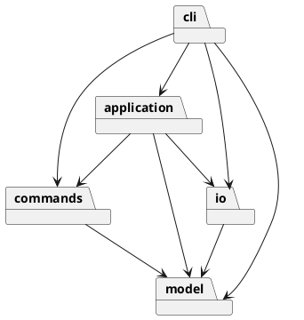
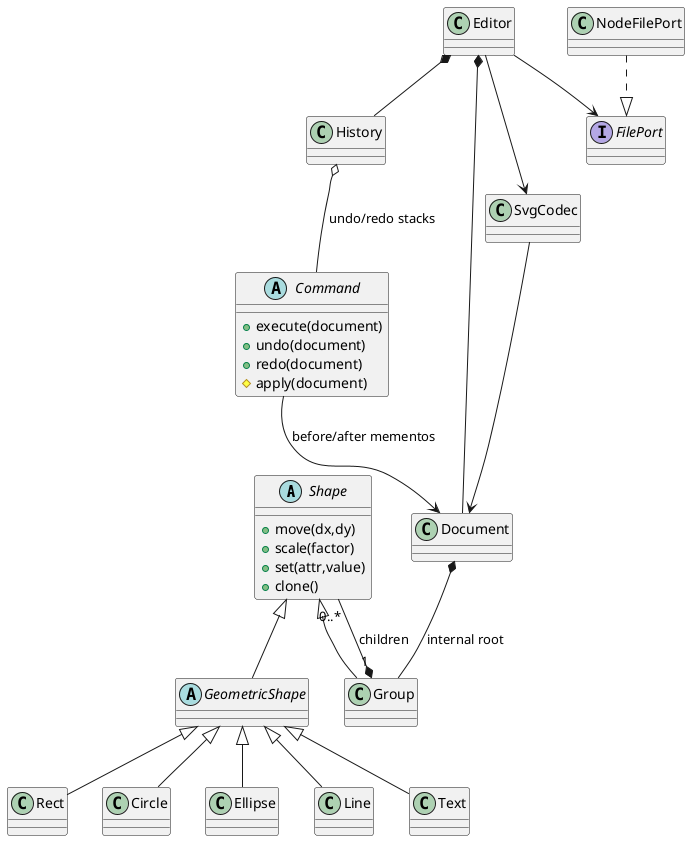

# Lab1 Phase 1 开发文档

## 初始架构方案（实现前）

模块：`model` 负责封装图形、Composite 与文档不变量；`commands` 负责编辑命令及精确撤销；`application` 负责会话状态、事务及历史边界；`io` 负责 SVG 解析与文件操作；`cli` 负责词法、命令分发和显示。每个类一个同名文件。

依赖方向：cli → application/commands/io/model；application → commands/model/io；commands → model；io → model；model 不依赖其他模块。命令接口与文件端口用 TypeScript interface，同样单独文件。

模式：Composite 统一容器与叶子操作；Command 表示一条编辑，使用文档快照 Memento 保证嵌套和顺序精确恢复；Factory 集中创建六种图形。按名字分派只有 CLI 命令表和 ShapeFactory 类型表两处，按原文暂标待重构；后续阶段才考虑注册扩展。不实现 box。

变化点假设：图形种类会增长，工厂集中但本阶段不预做插件；输入界面可能变成 GUI，命令与模型不引用 readline；存储可能换后端，文件接口可替换；撤销规模可能增大，先选简单可靠的快照，之后可换差量；SVG 特性远多于六种内置图形，导入明确验证和拒绝未支持语义，避免静默丢失。

## 真实过程记录

- 2026-10-30：用户通过父任务要求新建仓库并完成作业。AI 在独立新目录下载并读完 22,808 字节原始说明，确认顶层 g 不可 ungroup、文档命令的历史屏障、box 属后续阶段。
- 本机沙箱内 gh 初查显示认证失败；允许联网复查后已有钥匙串凭据可用。未创建 PAT、SSH 密钥或扩大 OAuth 权限。
- 本文件先于模型与命令实现提交。后续检查与修正只记录实际执行事实，不替学生编造个人评价。

## 一致性自查与质量保证

以下内容是实现后的实际记录，初始方案由最早的 `8bf834c` 提交保存。

### 最终模块职责与关键类

| 模块 | 职责与关键类 |
|---|---|
| `model` | `Shape` 封装 ID、父指针与样式；`GeometricShape` 封装数值和几何操作；Rect/Circle/Ellipse/Line/Text/Group 六个具体类；`Document` 维护唯一 ID、层级、前序顺序、分组和快照；`ShapeFactory` 是唯一类型名分派 |
| `commands` | `Command` 的 execute 模板保证原子应用并持有前后 Memento；Create/Delete/Move/Scale/Set/Group/Ungroup/AddTo/Order 各类只描述一条操作，不读写文件或输出终端 |
| `application` | `Editor` 持有当前文档和最近成功 read 的原路径，协调文件解析与成功提交；`History` 持有 Command 栈与 IO 屏障 |
| `io` | `FilePort` 可替换文件边界；`NodeFilePort` 同目录临时文件加 rename 原子替换；`SvgCodec` 用 saxes 解析 XML、预留 ID；`SvgElement` 为短生命周期解析树；`SvgTransform` 展开有限仿射变换 |
| `cli` | `Main` 连接 readline 和标准输入输出；`Tokenizer` 处理引用和整行注释；`Controller` 是唯一命令名分派；`Presenter` 输出树、属性和帮助 |

### 设计模式的实际落地

**Command + Memento**：`Command.execute` 先 clone 文档，应用操作后记录结果快照；抛错则 restore 初始快照。`History` 只在 execute 成功后入栈和清除 redo。undo/redo 恢复快照，不通过逆浮点运算猜测原值，因此嵌套层级、同级顺序、样式和文字都能精确回到旧状态。内存成本为 O(历史长度 × 文档大小)，本实验优先选择正确性，未实现差量压缩或无限规模保证。撤销反馈中的 `undone:` 指明先前操作已撤销，具体当前值可用 show/tree 查看。

**Composite**：Group 与叶子继承同一个 Shape；move/scale 通过虚方法递归，set 对共享样式统一处理，delete 以整棵子树为一个命令单元。文档层用 contains 检测祖先关系；不依赖 tag 名字判断容器，使用类和统一接口。

**Factory**：`ShapeFactory` 的单个表集中类型构造与参数默认值。导入复用同一工厂，通过实例的几何 schema 构建形状。`Controller` 的单个表集中命令语法入口。两处名字分派均有代码注释，按作业要求标记待重构；本阶段没有为了 box 提前搭建插件系统。

**文件端口**：应用依赖 FilePort 接口，真实 Node 文件与测试内存文件实现可替换。模型不读取文件，不输出错误，不知道终端。

### 依赖方向自查

最终目录与初始五模块一致。新增 SvgElement/SvgTransform 是 io 内部细分，未新增逆向依赖；增加 test、scripts、examples、submission 和 CI 为验证及交付材料，不作为业务模块。

`contracts.test.ts` 扫描所有源码的 import，检查与初始依赖表一致，同时检查每个类的文件名和一类一文件规则。实际通过。抽样：Rect → GeometricShape（model 内）；MoveCommand → Document/Validation（commands → model）；History → Command/Document（application → commands/model）；SvgCodec → ShapeFactory/Document（io → model）；Main → Editor/NodeFilePort（cli → application/io）。Shape 的 Group 父指针是 model 内 `import type`，不会引入运行时反向初始化问题。

没有发现违反既定模块依赖方向的源码。当前没有第三处按图形名或命令名分派，也没有 switch(tag)。XML transform 的语法解析是文件格式语法校验，不用于图形类型分派。

### 变化点假设与最终选择

1. 图形扩展：六个具行为的具体类与工厂集中变更；继承后的坐标 schema 决定几何操作。box 未实现，命令给出原文约定错误；插件是后续重构目标。
2. 输入通道：命令和模型与 readline 无关，未来 GUI 可复用 Editor/Command。CLI 目前同步处理，未为无要求的并发编辑预留协同协议。
3. 存储后端：FilePort 隔离存储；SvgCodec 只做字符串/Document 转换。
4. 历史规模：Memento 的内存成本已明确；未来可替换为命令差量，但本阶段不为优化牺牲原子性。
5. SVG 兼容范围：验证子集，拒绝未支持语义；在原计划安全拒绝 transform 基础上补充了可证明正确的 translate/等比 scale，仍未声称通用 SVG 导入。
6. 属性传播：普通 g 使用 SVG 继承语义。addto/group/ungroup 改变归属时，未额外冻结旧父容器继承的样式；几何和层级按命令规则处理。这是当前明确的语义边界，后续若要求“外观无损重分组”，可加入计算样式固化策略。

### 真实讨论、审查与迭代续记

以下发现和修正由 AI 执行，不代表学生亲自审查或表达了个人评价。

| 阶段/提交 | 实际讨论、发现与处理 |
|---|---|
| `8bf834c` | 先保存架构、依赖规则和阶段边界，随后才实现源码 |
| `216d7c2` | 实现六种封装图形、Composite、层级和前序顺序。首次 tsx CLI 测试触发沙箱 IPC 权限错误，改为 `node --import tsx` 后测试成功；没有把失败运行算作通过 |
| `c151354` | 引入 Command 前后快照和 History，测试递归缩放中途溢出后完整回滚、redo 保持和删除整棵子树恢复 |
| `a4c999a` | IO 隔离；导入先预留全部显式 ID，避免给前面的匿名元素分配后来已用的 ID；文件成功后才更新路径和历史 |
| `67855e1` | 完成 REPL/帮助/树/属性，逐条错误回归和真实 CLI 子进程；ESLint 对有意使用控制字符范围的 XML 验证正则报错，在该两行加有理由的局部豁免，未关闭全局规则 |
| `7e6c158` | 父任务审查指出原文 0.1 的 transform 示例值得支持。AI 将最初“明确拒绝 transform”改为有限 translate/正数等比 scale 展开，补矩阵顺序、嵌套、线宽/字号和 roundtrip 测试；拒绝旋转、非等比缩放等 |
| `f812832` | AI 继续审查发现原子写 cleanup 可能掩盖原始错误，改为失败时 best-effort 清理；同时拒绝资源 URL/转义 paint 与变换尾分隔符，并添加回归 |
| `d4af0ae` | 回放原文典型会话与流程图、保存实际 SVG；增加全部几何 setter、依赖方向和文件命名契约；配置 Node 22/24 CI |
| 最终文档阶段 | 补充已运行 QA、提交用 README 和仓库可见性。用户后续授权公开后，首次文档替换脚本因环境编码错误未生效，AI 检查时发现并用后续真实提交纠正。未伪造学生参与、学号、个人心得、测试结果或历史；未代交 eLearning |

上述提交按实际完成阶段顺序创建并推送，没有先完成整个项目再回填假历史。完整原始说明只在本任务的本地参考目录保留，核验 22,808 字节，没有加入本仓库。

### 质量保证

详见 [QA.md](QA.md)。已执行 `npm run check`：源码及测试 TypeScript 检查、ESLint、20 项测试、构建均通过；失败不变性测试逐条检查 36 类错误，并在每次失败后 redo 验证旧分支仍存在。通过真实文件原子替换测试、CLI 子进程和三个原文场景回放。

V8 实测覆盖率（Node 26.5.0、tsx 加载器，含 save 修复回归）为行 99.63%、分支 95.67%、函数 99.04%，只作为辅助证据，不等同于形式证明。Node 22/24 的 GitHub Actions 已实际通过（初始对应 d4af0ae）；最终提交的远端状态另以 final 标签和 Actions 为准。

### 用户后续授权：公开仓库

用户于 2026-10-30 11:18:26 UTC 明确要求将当前作业仓库改为 public 并继续完成作业。AI 在更改前扫描全部 68 个已提交历史 blob 的凭据模式与文件路径，并检查所跟踪文件清单：未发现凭据、学号或完整课程说明。公开内容为实现、开发文档和必要的自主整理说明/最小场景示例。随后仅将 `Zyrrick/fudan-svg-cli-lab1` 改为 PUBLIC，并通过 GitHub 返回值核验；没有改写已有历史或操作其他仓库。历史中早期 private 的记录保留为当时事实。

### 提交说明复核与 final 标签更新

父任务复核指出提交说明中的身份资料表述不准确，并要求面向老师呈现验收信息。AI 删除该失实表述，将访问说明简化为“公开仓库，可直接访问”，移除权限操作、扫描和附件预览/提交状态等内部叙述；保留真实 AI 协作披露、运行方法、验证结果和限制。检查其他当前文档，没有发现同类身份资料声明；公开文档不新增个人身份编号。

本次以新的文档修正提交保留真实记录，不改写已有提交历史。课程尚未提交，按明确要求在重新检查后将 `final` 从 `0c8597cef20484e69f9395697d9d391057e0d63e` 更新到本次修正提交，并重新核验远端标签与 main 一致；源码归档与独立提交 README 同步更新。

### 原文 save 语义复核与修正

最终只读复核发现原实现把默认保存路径解释为“最近成功 read/save 的路径”，与原文“读入时的路径”有差异。AI 用内存文件复现 `read original.svg → save copy.svg → 编辑 → save`，确认错误地写入副本。随后按原文修复：Editor 只在成功 read 后记录来源，显式 save 不改变来源，成功 init 清除来源；init 后无来源的无参数 save 报错且不改变文档或历史。

新增三项回归，核验另存后仍保存原文件、显式/默认保存失败的来源与 redo 不变性、init 清除来源及成功保存的 undo/redo 屏障；总测试数由 17 增至 20。旧测试中默认保存来自显式 save 的假设也同步改为先 read。CLI 帮助和 README 已统一为原文字义。修复以新 fix 提交保存真实历史，完整检查与对应 CI 通过后，将 `final` 从 `ac0f1057ce203226f4277f7083698167fa8c70c4` 更新到本次修正提交，并重新生成交付附件。
