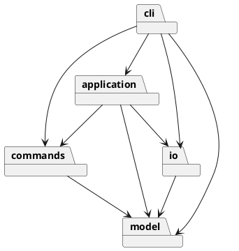

# Lab1 Phase 1 开发文档

## 初始架构方案（实现前）

模块：`model` 负责封装图形、Composite 与文档不变量；`commands` 负责编辑命令及精确撤销；`application` 负责会话状态、事务及历史边界；`io` 负责 SVG 解析与文件操作；`cli` 负责词法、命令分发和显示。每个类一个同名文件。

依赖方向：cli → application/commands/io/model；application → commands/model/io；commands → model；io → model；model 不依赖其他模块。命令接口与文件端口用 TypeScript interface，同样单独文件。

模式：Composite 统一容器与叶子操作；Command 表示一条编辑，使用文档快照 Memento 保证嵌套和顺序精确恢复；Factory 集中创建六种图形。按名字分派只有 CLI 命令表和 ShapeFactory 类型表两处，按原文暂标待重构；后续阶段才考虑注册扩展。不实现 box。

变化点假设：图形种类会增长，工厂集中但本阶段不预做插件；输入界面可能变成 GUI，命令与模型不引用 readline；存储可能换后端，文件接口可替换；撤销规模可能增大，先选简单可靠的快照，之后可换差量；SVG 特性远多于六种内置图形，导入明确验证和拒绝未支持语义，避免静默丢失。

## 真实过程记录

- 2026-10-30：用户通过父任务要求新建仓库并完成作业。AI 在独立新目录下载并读完 22,808 字节原始说明，确认顶层 g 不可 ungroup、文档命令的历史屏障、box 属后续阶段。
- 本机沙箱内 gh 初查显示认证失败；允许联网复查后已有钥匙串凭据可用。未创建 PAT、SSH 密钥或扩大 OAuth 权限。
- 本文件先于模型与命令实现提交。后续检查与修正只记录实际执行事实，不替学生编造个人评价。

## 一致性自查与质量保证

实现完成后补充真实结果。
