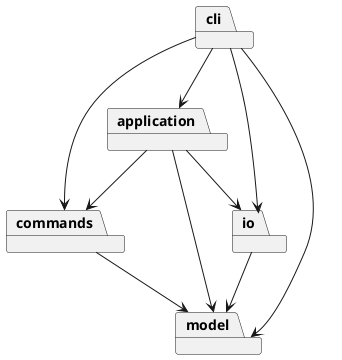
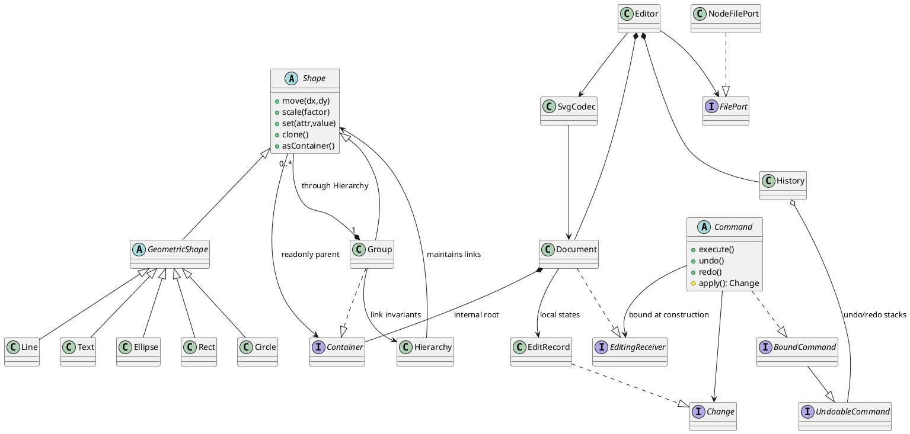

# Lab1 Phase 1 开发文档

## 初始架构方案与课程复核修订

初始方案在最早提交 `8bf834c` 中保存。其全量文档快照选择已在课程复核后替换为 Receiver 产生的局部状态；本文件下方“最终模块职责”和模式说明反映修订后的实现。具体课堂依据与本轮红绿证据见 [COURSE-REVIEW.md](COURSE-REVIEW.md)。

模块：`model` 负责封装图形、Composite 与文档不变量；`commands` 负责编辑命令及精确撤销；`application` 负责会话状态、事务及历史边界；`io` 负责 SVG 解析与文件操作；`cli` 负责词法、命令分发和显示。每个类一个同名文件。

依赖方向：cli → application/commands/io/model；application → commands/model/io；commands → model；io → model；model 不依赖其他模块。命令接口与文件端口用 TypeScript interface，同样单独文件。

模式：Composite 统一容器与叶子操作；Command 在创建时绑定 Receiver，每条编辑保留受影响属性/几何/结构位置的前后状态，保证精确恢复；Factory 集中创建六种图形。按名字分派只有 CLI 命令表和 ShapeFactory 类型表两处，按原文暂标待重构；后续阶段才考虑注册扩展。不实现 box。

变化点假设：图形种类会增长，工厂集中但本阶段不预做插件；输入界面可能变成 GUI，命令与模型不引用 readline；存储可能换后端，文件接口可替换；撤销规模会增大，因此课程复核后采用局部状态，仍保留精确浮点值而不反算；SVG 特性远多于六种内置图形，导入明确验证和拒绝未支持语义，避免静默丢失。

## 真实过程记录

- 2026-10-30：用户通过父任务要求新建仓库并完成作业。AI 在独立新目录下载并读完 22,808 字节原始说明，确认顶层 g 不可 ungroup、文档命令的历史屏障、box 属后续阶段。
- 本机沙箱内 gh 初查显示认证失败；允许联网复查后已有钥匙串凭据可用。未创建 PAT、SSH 密钥或扩大 OAuth 权限。
- 本文件先于模型与命令实现提交。后续检查与修正按实际执行记录。

## 一致性自查与质量保证

以下内容是实现后的实际记录，初始方案由最早的 `8bf834c` 提交保存。

### 最终模块职责与关键类

| 模块 | 职责与关键类 |
|---|---|
| `model` | Shape/GeometricShape 与六种具体图形封装行为；Container 是容器契约，Hierarchy 原子维护父子双向关系；Document 实现 EditingReceiver，维护编辑业务与事务；EditRecord、GeometryState、PropertyState、PlacementState 保留局部状态；ShapeFactory 是唯一类型名分派并实现 ShapeProvider |
| `commands` | UndoableCommand/BoundCommand 定义契约；Command 持有 Receiver 和 Change，维护执行生命周期；九种具体命令只保存参数并委托业务，不读写文件或输出终端 |
| `application` | Editor 持有当前文档及 read 来源，拒绝错绑/旧文档命令；History 只依赖 UndoableCommand，是统一 Invoker，维护两栈与 IO 屏障 |
| `io` | `FilePort` 可替换文件边界；`NodeFilePort` 同目录临时文件加 rename 原子替换；`SvgCodec` 用 saxes 解析 XML、预留 ID；`SvgElement` 为短生命周期解析树；`SvgTransform` 展开有限仿射变换 |
| `cli` | `Main` 连接 readline 和标准输入输出；`Tokenizer` 处理引用和整行注释；`Controller` 是唯一命令名分派；`Presenter` 输出树、属性和帮助 |

### 设计模式的实际落地

**Command 与局部 Memento**：Client 是 Controller，创建具体命令时绑定 EditingReceiver；Invoker 是 History，只调用无文档参数的 execute/undo/redo；Receiver 是 Document。Create 的唯一性检查、工厂构造、挂接均在 Receiver，其他编辑同样由 Receiver 执行业务。Command 只持有返回的 Change，状态仅在成功后前进。History 同样只在成功后移动两栈和清空 redo。

Receiver 产生 EditRecord：move/scale 保存受影响 K 个叶子的前后几何值，set 保存单个属性值及缺省状态；结构操作保留对象、父级和位置，group/ungroup 保留成员顺序。失败时 Receiver 回滚局部状态；结构恢复本身失败也会回滚到恢复前的位置。删除保留原对象及子树，不复制无关图形。精确原值使撤销不依赖负 dx 或倒数 factor，避免浮点漂移。编辑历史不调用 Document.clone/restore 或 Shape.clone；显式复制 API 仍可独立使用。

局部历史的主要空间为几何/属性变更值和被删除对象、结构位置，取决于实际受影响范围；整组缩放仍是 O(K)，并不承诺所有命令 O(1)。Document 当前 ID 查找仍遍历全文档，结构操作还可能移动同级数组，这些时间成本没有因取消快照而消失。撤销反馈中的 undone 指先前操作已撤销，当前值可用 show/tree 查看。

**Composite（安全式）**：Group 与叶子继承 Shape，容器另实现 Container；叶子不提供 add/remove，asContainer 查询会明确抛错。Group 的 add 通过 Hierarchy 同时维护父指向及子列表并自行防环，Shape 没有 public attach，父级类型不再依赖具体 Group。move/scale 递归委派；set 用 SVG 样式继承；delete 作为子树编辑。Document、Presenter、SvgElement、SvgTransform 均不对具体图形做 instanceof，通过 children/asContainer/importArguments/importChildren/importTransform 等多态能力工作。

**Factory**：`ShapeFactory` 的单个表集中类型构造与参数默认值。导入复用同一工厂，通过实例的几何 schema 构建形状。`Controller` 的单个表集中命令语法入口。两处名字分派均有代码注释，按作业要求标记待重构；本阶段没有为了 box 提前搭建插件系统。

**接口与文件端口**：应用依赖 FilePort，History 依赖 UndoableCommand，具体命令依赖 EditingReceiver，SVG 导入依赖 ShapeProvider。测试可以替换 Receiver、Invoker 命令和图形工厂，不需要更改客户端遍历。模型不读文件、不接终端；没有为课程其他模式追加无需求功能。

### 依赖方向自查

最终目录与初始五模块一致。新增 SvgElement/SvgTransform 是 io 内部细分，未新增逆向依赖；增加 test、scripts、examples、submission 和 CI 为验证及交付材料，不作为业务模块。

`contracts.test.ts` 扫描源码 import、类文件命名及模块依赖规则。实际通过。抽样：MoveCommand → EditingReceiver/Validation（commands → model）；History → UndoableCommand（application → commands）；SvgElement → ShapeProvider（io → model）；Main → Editor/NodeFilePort（cli → application/io）。Shape 的父级仅依赖 Container 接口；Hierarchy 对 Shape/Container 使用类型导入，没有 Shape↔Group 的具体类反向耦合。course.test.ts 另检查客户端没有具体组件 instanceof。

没有发现违反既定模块依赖方向的源码。当前没有第三处按图形名或命令名分派，也没有 switch(tag)。XML transform 的语法解析是文件格式语法校验，不用于图形类型分派。

### 变化点假设与最终选择

1. 图形扩展：六个具行为的具体类与工厂集中变更；继承后的坐标 schema 决定几何操作。box 未实现，命令给出原文约定错误；插件是后续重构目标。
2. 输入通道：命令和模型与 readline 无关，未来 GUI 可复用 Editor/Command。CLI 目前同步处理，未为无要求的并发编辑预留协同协议。
3. 存储后端：FilePort 隔离存储；SvgCodec 只做字符串/Document 转换。
4. 历史规模：已从全量快照改成局部精确状态，同负载测量见课程复核。历史仍无持久化或自动裁剪，大量删除/大子树编辑仍可保留较多数据；后续可讨论预算与索引，但不能静默牺牲原子性或精确撤销。
5. SVG 兼容范围：验证子集，拒绝未支持语义；在原计划安全拒绝 transform 基础上补充了可证明正确的 translate/等比 scale，仍未声称通用 SVG 导入。
6. 属性传播：普通 g 使用 SVG 继承语义。addto/group/ungroup 改变归属时，未额外冻结旧父容器继承的样式；几何和层级按命令规则处理。这是当前明确的语义边界，后续若要求“外观无损重分组”，可加入计算样式固化策略。

### 真实讨论、审查与迭代续记

以下为 Codex 协作过程中的实际讨论、验证与修正记录。

| 阶段/提交 | 实际讨论、发现与处理 |
|---|---|
| `8bf834c` | 先保存架构、依赖规则和阶段边界，随后才实现源码 |
| `216d7c2` | 实现六种封装图形、Composite、层级和前序顺序。首次 tsx CLI 测试触发沙箱 IPC 权限错误，改为 `node --import tsx` 后测试成功；没有把失败运行算作通过 |
| `c151354` | 引入 Command 前后快照和 History，测试递归缩放中途溢出后完整回滚、redo 保持和删除整棵子树恢复 |
| `a4c999a` | IO 隔离；导入先预留全部显式 ID，避免给前面的匿名元素分配后来已用的 ID；文件成功后才更新路径和历史 |
| `67855e1` | 完成 REPL/帮助/树/属性，逐条错误回归和真实 CLI 子进程；ESLint 对有意使用控制字符范围的 XML 验证正则报错，在该两行加有理由的局部豁免，未关闭全局规则 |
| `7e6c158` | 父任务审查指出原文 0.1 的 transform 示例值得支持。AI 将最初“明确拒绝 transform”改为有限 translate/正数等比 scale 展开，补矩阵顺序、嵌套、线宽/字号和 roundtrip 测试；拒绝旋转、非等比缩放等 |
| `f812832` | AI 继续审查发现原子写 cleanup 可能掩盖原始错误，改为失败时 best-effort 清理；同时拒绝资源 URL/转义 paint 与变换尾分隔符，并添加回归 |
| `d4af0ae` | 回放原文典型会话与流程图、保存实际 SVG；增加全部几何 setter、依赖方向和文件命名契约；配置 Node 22/24 CI |
| 最终文档阶段 | 补充已运行 QA、提交用 README 和仓库可见性。用户后续授权公开后，首次文档替换脚本因环境编码错误未生效，AI 检查时发现并用后续真实提交纠正。 |

上述提交按实际完成阶段顺序创建并推送，没有先完成整个项目再回填假历史。完整原始说明只在本任务的本地参考目录保留，核验 22,808 字节，没有加入本仓库。

### 质量保证

详见 [QA.md](QA.md)。已执行 `npm run check`：源码及测试 TypeScript 检查、ESLint、36 项测试、构建均通过；失败不变性测试逐条检查 36 类错误，并在每次失败后 redo 验证旧分支仍存在。通过真实文件原子替换测试、CLI 子进程和三个原文场景回放。

本轮 V8 实测覆盖率（Node 26.5.0、tsx 加载器）为行 99.34%、分支 96.80%、函数 98.48%，只作为辅助证据，不等同于形式证明。旧版本的 Node 22/24 CI 已通过；课程重构的最终远端验证以对应提交的 Actions 为准，不将本地结果替代远端结果。

### 用户后续授权：公开仓库

用户于 2026-10-30 11:18:26 UTC 明确要求将当前作业仓库改为 public 并继续完成作业。AI 在更改前扫描全部 68 个已提交历史 blob 的凭据模式与文件路径，并检查所跟踪文件清单：未发现凭据、学号或完整课程说明。公开内容为实现、开发文档和必要的自主整理说明/最小场景示例。随后仅将 `Zyrrick/fudan-svg-cli-lab1` 改为 PUBLIC，并通过 GitHub 返回值核验；没有改写已有历史或操作其他仓库。历史中早期 private 的记录保留为当时事实。

### 提交说明复核与 final 标签更新

父任务复核指出提交说明中的身份资料表述不准确，并要求面向老师呈现验收信息。AI 删除该失实表述，将访问说明简化为“公开仓库，可直接访问”，移除权限操作、扫描和附件预览/提交状态等内部叙述；保留真实 AI 协作披露、运行方法、验证结果和限制。检查其他当前文档，没有发现同类身份资料声明；公开文档不新增个人身份编号。

本次以新的文档修正提交保留真实记录，不改写已有提交历史。课程尚未提交，按明确要求在重新检查后将 `final` 从 `0c8597cef20484e69f9395697d9d391057e0d63e` 更新到本次修正提交，并重新核验远端标签与 main 一致；源码归档与独立提交 README 同步更新。

### 原文 save 语义复核与修正

最终只读复核发现原实现把默认保存路径解释为“最近成功 read/save 的路径”，与原文“读入时的路径”有差异。AI 用内存文件复现 `read original.svg → save copy.svg → 编辑 → save`，确认错误地写入副本。随后按原文修复：Editor 只在成功 read 后记录来源，显式 save 不改变来源，成功 init 清除来源；init 后无来源的无参数 save 报错且不改变文档或历史。

新增三项回归，核验另存后仍保存原文件、显式/默认保存失败的来源与 redo 不变性、init 清除来源及成功保存的 undo/redo 屏障；总测试数由 17 增至 20。旧测试中默认保存来自显式 save 的假设也同步改为先 read。CLI 帮助和 README 已统一为原文字义。修复以新 fix 提交保存真实历史，完整检查与对应 CI 通过后，将 `final` 从 `ac0f1057ce203226f4277f7083698167fa8c70c4` 更新到本次修正提交，并重新生成交付附件。

### 交付文档表述整理

按课程要求保留本文件的真实 AI 协作过程、具体讨论、验证和迭代事实；删除根 README、提交说明及 QA 中重复的制作身份声明，未改写为学生独立完成，也不改变既有提交历史或程序功能。本次文档整理另作新提交，检查与 CI 通过后将 `final` 从 `d72d8d0f1b8c95f67a901b231aaf3514a29d76ad` 更新到本次文档提交，并同步更新提交 README 和源码归档。

### 课程课件复核后的设计修正

此前实现读过完整实验说明，但尚未完成课程课件审查；用户指出后，父任务团队实际读完 10 份、287 页课件并核对关键图表。本轮依据其提供的具体页码复核，不把后来阅读写成最初已读，也不把课堂倡导全部视为作业硬性要求。依据、取舍及验收见 [COURSE-REVIEW.md](COURSE-REVIEW.md)。

- `a5d022f`：先新增并运行 9 项设计失败测试，退出码 1，保存真实红阶段。
- `3c3b048`：Receiver 产生局部状态、Hierarchy 维护双向父子关系、移除客户端的具体类型判断；先运行 7 项原有模型/IO 回归通过。
- `e6c4f07`：命令构造绑定 Receiver、History 改依赖无文档入参的接口；完整检查达到 29/29 绿阶段。
- 后续验证增加替身 Receiver、非 Group/Text 子类的测试组件、多父级结构恢复、实际恢复失败的回滚和 Invoker 栈不变性；目前共 36 项通过。历史中旧测试只迁移装配签名，行为断言保留；本轮红绿过程不追写到原开发阶段。

同负载资源测量中，1000 个矩形、50 条单叶移动历史从克隆 100100 个对象、约 57.49 MiB 增量，变为 0 次克隆、100 次局部几何采集、约 0.063 MiB 增量；一次 undo/redo 同样为 0 次克隆。该参考测量不是所有工作负载或平台的性能保证，大子树与删除对象仍需相应状态空间。
